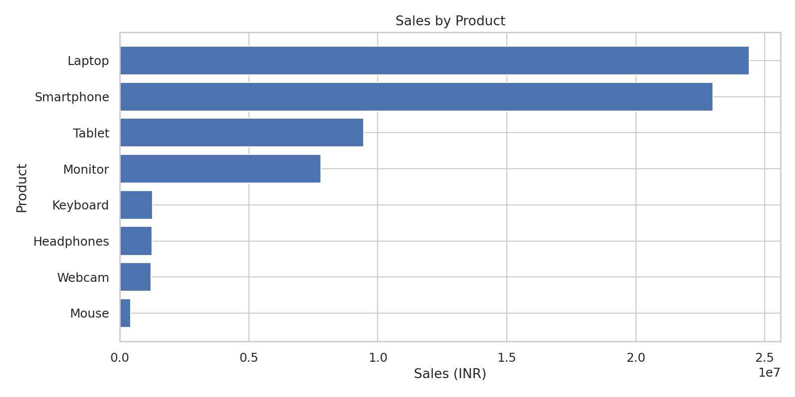
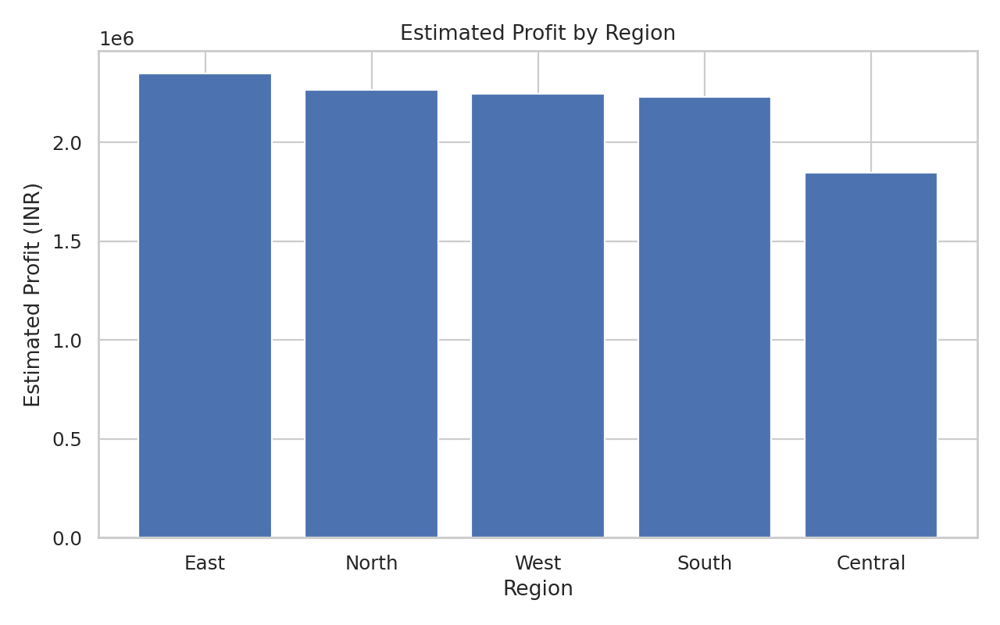
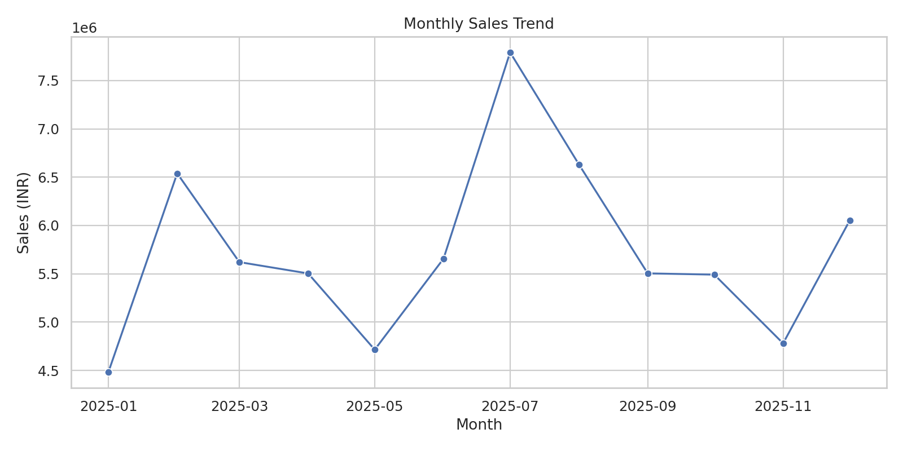
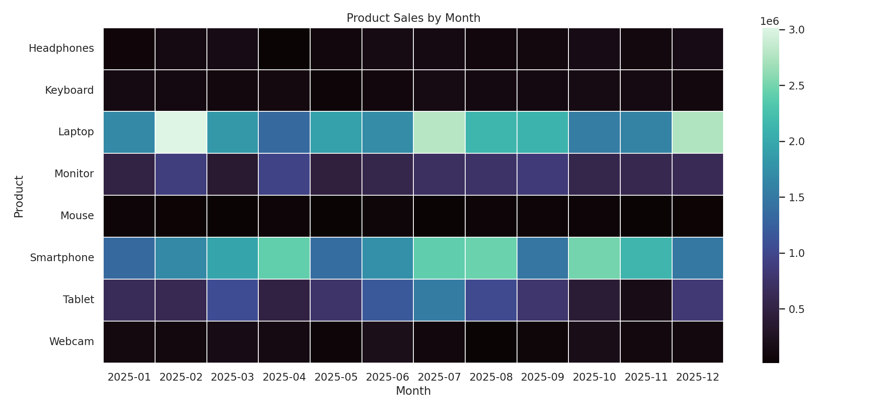

# Sales Data Analysis

🚀 **Live Dashboard:** [Click here to explore](https://udsgzsggkww4ea.streamlit.app/)

[](https://udsgzsggkww4ea.streamlit.app/)

A beginner-friendly data analytics portfolio project using Python, Pandas, Matplotlib, and Seaborn.

> **Dataset note:** `data/sales.csv` is a synthetic sample dataset generated for demonstration and learning. It is not real company/customer data. Monetary values are in Indian Rupees (INR).

## Business Questions
- What are total sales, estimated profit, and profit margin?
- Which products contribute the most sales?
- Which regions generate the most estimated profit?
- How do sales change month by month?
- How do product sales vary across months?

## Tech Stack
- Python
- Pandas and NumPy
- Matplotlib and Seaborn
- CSV data processing

## Project Structure
```text
sales-data-analysis/
├── data/sales.csv
├── src/analysis.py
├── outputs/charts/
├── outputs/product_summary.csv
├── outputs/region_summary.csv
├── requirements.txt
└── README.md
```

## Run Locally
```bash
pip install -r requirements.txt
python src/analysis.py
```

The script prints a sales summary, creates charts in `outputs/charts/`, and exports product/region summary CSVs into `outputs/`.

## Key Metrics
- Number of orders
- Units sold
- Total sales (INR)
- Estimated profit (INR)
- Average order value
- Estimated profit margin

## Important Assumptions
- One row represents one order line; an order ID is unique per row in this sample.
- Estimated cost is calculated from fixed illustrative cost ratios by product.
- Profit is an estimate based on sales minus estimated cost, not audited financial data.
- The dataset is randomly generated and should not be represented as actual business performance.

## Possible Improvements
- Add a Power BI dashboard
- Add automated data-quality checks and unit tests
- Compare sales channels and discount levels
- Build a Streamlit dashboard

- ---

## 📊 Project Visualizations

The project generates charts to explore sales performance, product contributions, regional performance, and monthly trends.

### 1. Sales by Product


### 2. Profit by Region


### 3. Monthly Sales Trend


### 4. Product Month Heatmap


---

## 📁 Generated Reports

- [Product Summary CSV](outputs/product_summary.csv)
- [Region Summary CSV](outputs/region_summary.csv)

---
---

## 📊 Project Results & Key Findings

### Key Insights

- **Top-Selling Products:** Identified products contributing the most to total sales.
- **Regional Performance:** Compared estimated profit across different regions.
- **Monthly Sales Trends:** Analyzed month-by-month sales fluctuations.
- **Product Performance:** Used a heatmap to compare product sales across months.
- **Data-Driven Decisions:** Visualizations help identify sales patterns and areas for further investigation.

### Business Value

- Helps businesses understand product performance.
- Supports regional sales and profit comparisons.
- Highlights monthly sales trends.
- Makes complex sales data easier to understand through visualizations.

### Tools Used

- Python
- Pandas
- NumPy
- Matplotlib
- Seaborn

> **Note:** This project uses synthetic sample data for educational and demonstration purposes. The findings do not represent actual company performance.

---

## 📝 Conclusion

This Sales Data Analysis project demonstrates how Python can be used to analyze sales data and generate meaningful business insights.

The project includes data processing, summary report generation, and visualizations for product sales, regional profit, monthly sales trends, and product performance.

Through this project, I practiced working with Pandas, NumPy, Matplotlib, and Seaborn to turn raw data into useful information.

## 🚀 Future Enhancements

- Build an interactive dashboard using Streamlit.
- Add a Power BI dashboard.
- Perform data-quality checks.
- Explore sales forecasting using machine learning.

---

## 📊 Key Findings

- **Total Orders:** Analyzed 1,200 sample order records.
- **Total Sales:** Generated ₹6,87,70,810 in sample sales.
- **Estimated Profit:** ₹1,09,41,788 with an estimated profit margin of 15.91%.
- **Top-Selling Product:** Laptop generated the highest sales at ₹2,43,98,400, followed by Smartphone at ₹2,29,89,400.
- **Best-Performing Region:** East recorded the highest estimated profit of ₹23,48,069.
- **Peak Sales Month:** July 2025 recorded the highest monthly sales of ₹77,90,935.
- **Data Visualization:** Created four charts to analyze product sales, regional profit, monthly trends, and product performance.
- **Reports:** Generated product-wise and region-wise CSV summary reports.

> **Note:** All figures are based on a synthetic sample dataset created for learning and demonstration. They do not represent actual company performance.

## 🛠️ Skills Demonstrated

- Python programming
- Data cleaning and processing with Pandas
- Numerical analysis with NumPy
- Data visualization with Matplotlib and Seaborn
- Generating CSV reports
- Organizing a Python data analysis project
